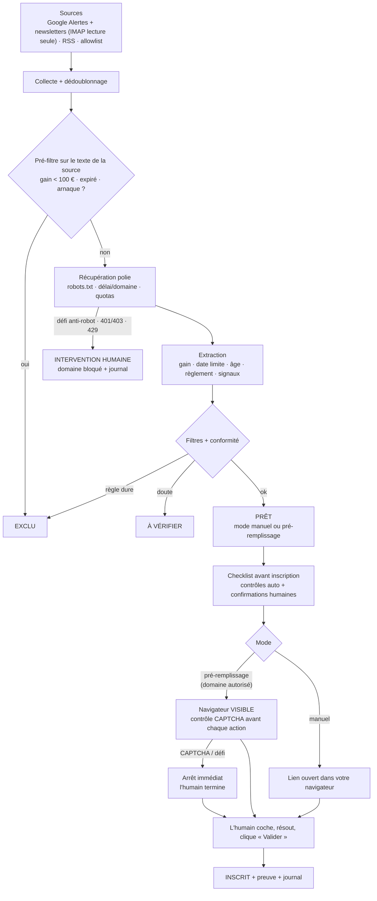
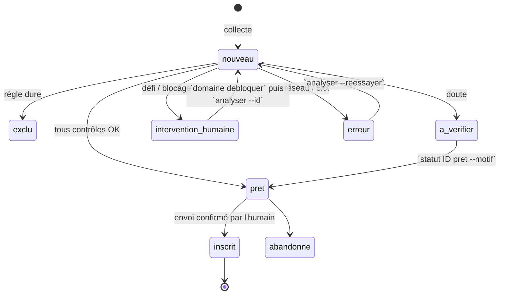

# Architecture

## 1. Vue d'ensemble

L'outil est un **assistant**, pas un bot. Il trouve les concours, les trie, vérifie
qu'ils sont sûrs et conformes, peut pré-remplir un formulaire… puis **c'est toujours
l'humain qui envoie**.

## 2. Modules

| Module | Rôle |
|---|---|
| `sources/rss.py` | Lit les flux RSS/Atom via le client poli. |
| `sources/newsletter.py` | Lit un dossier IMAP en **lecture seule** (`BODY.PEEK`) : Google Alertes (liens de redirection déballés) et newsletters. |
| `sources/allowlist.py` | URLs ajoutées à la main. |
| `http_poli.py` | Seule porte de sortie réseau : robots.txt, délais, quotas, arrêt sur défi, blocage de domaine. |
| `detection.py` | Reconnaît les CAPTCHA et pages de challenge **pour s'arrêter**, jamais pour les traiter. |
| `extraction.py` | Heuristiques : montants (€), date limite, âge minimum, lien du règlement, signaux d'arnaque, clause anti-automatisation, SIREN/RCS, dépôt chez un commissaire de justice. |
| `conformite.py` | `evaluer()` décide du statut et du mode ; `checklist_avant_inscription()` contrôle juste avant l'envoi. |
| `analyse.py` | Orchestration : pré-filtre → récupération → résolution du lien d'agrégateur → règlement → décision. |
| `prefill.py` | Navigateur visible, remplissage des seuls champs non ambigus, **aucun clic, aucune case cochée**. Mode manuel. |
| `db.py` + `schema.sql` | SQLite : concours, domaines, consentements, journal. |
| `journal.py` | Journal d'audit, données personnelles masquées. |
| `vie_privee.py` | Consentement, export, purge. |
| `cli.py` | Commandes `concours …`. |

## 3. Stack recommandée

| Besoin | Choix | Pourquoi |
|---|---|---|
| Langage | Python ≥ 3.11 | `tomllib` intégré, typage moderne. |
| HTTP | `requests` + `urllib.robotparser` | Simple, synchrone (donc séquentiel = poli par construction). |
| Flux | `feedparser` | Standard RSS/Atom. |
| HTML | `beautifulsoup4` | Extraction texte + liens. |
| PDF (règlements) | `pypdf` | Beaucoup de règlements sont en PDF. |
| Navigateur | **Playwright**, `headless=False` en dur | Attente automatique des éléments, inspection des iframes. Selenium convient aussi, avec les mêmes règles : mode visible, aucune option furtive, aucun clic d'envoi. |
| Stockage | SQLite | Local, un seul fichier, facile à purger/exporter. |
| Tests | `pytest` | 86 tests, sans réseau. |

**Bannis volontairement** : `undetected-chromedriver`, `playwright-stealth`,
`puppeteer-extra-plugin-stealth`, rotation de proxies, faux User-Agent, modification de
`navigator.webdriver`, simulation de frappe/souris « humaine », services de résolution de
CAPTCHA. Le User-Agent est validé au chargement : s'il imite un navigateur
(`Mozilla`, `Chrome`, `Safari`), la configuration est refusée.

## 4. Workflow détaillé

| Étape | Commande | Ce qui se passe |
|---|---|---|
| 1. Collecte | `concours collecter` | RSS (robots.txt vérifié), newsletters IMAP (lecture seule), allowlist. Dédoublonnage à l'insertion. |
| 2. Extraction | `concours analyser` | Pré-filtre sans réseau si le texte de la source suffit. Sinon : page → lien sortant (agrégateur) → page réelle → 1 règlement (HTML ou PDF). |
| 3. Filtre ≥ 100 € | (auto) | `lot_principal` (défaut) ou `dotation_totale`. Valeur inconnue = « à vérifier », jamais acceptée d'office. Seuil < 100 € refusé par la configuration. |
| 4. Conditions d'automatisation | (auto) | Mode **pré-remplissage** seulement si : domaine autorisé par vous (`concours domaine autoriser`, justification obligatoire) **et** règlement sans clause anti-automatisation **et** pas de CAPTCHA. Sinon mode **manuel**. |
| 5. Checklist | `concours participer ID` | Contrôles automatiques (bloquants) + confirmations humaines. |
| 6. Pré-remplissage | (auto si autorisé) | Navigateur visible, contrôle de défi avant chaque champ. |
| 7. Arrêt CAPTCHA/anti-bot | (auto) | Arrêt immédiat, journal, la main passe à l'humain ; un défi d'accès bloque le domaine. |
| 8. Validation manuelle + envoi | (vous) | Vous cochez, résolvez, cliquez « Valider ». |
| 9. Journalisation | (auto) | Statut `inscrit`, date, preuve (capture de la page de confirmation), événement d'audit. |

### Cycle de vie d'un concours

## 5. Schéma de base de données

Source de vérité : [`concours_assistant/schema.sql`](../concours_assistant/schema.sql).

**`concours`** : `id`, `url`, `url_canonique` (unique), `url_participation`,
`url_participation_canonique`, `empreinte`, `nom`, `organisateur`, `source`,
`texte_source`, `gain_principal_eur`, `dotation_totale_eur`, `date_limite`,
`age_minimum`, `url_reglement`, `conditions` (JSON : infos extraites + contexte de
conformité), `mode_assistance`, `motifs` (JSON), `avertissements` (JSON), `statut`,
`date_decouverte`, `date_analyse`, `date_inscription`, `preuve`, `maj_le`.

**`domaines`** : `domaine`, `automatisation_autorisee`, `justification`, `verifie_le`,
`bloque_jusqu_au`, `raison_blocage`.

**`consentements`** : `version`, `accorde_le`, `retire_le`.

**`journal`** : `horodatage`, `type`, `concours_id`, `domaine`, `details` (JSON masqué).

## 6. Doublons, limitation de débit, erreurs

### Doublons (3 clés)
1. `url_canonique` : hôte en minuscules, sans `www`, sans fragment ni paramètres de suivi (`utm_*`, `fbclid`, `gclid`…), paramètres triés.
2. `url_participation_canonique` : le même concours vu par deux agrégateurs pointe vers la même page réelle → le second est exclu « doublon de #N ».
3. `empreinte` : domaine + titre normalisé, sur 60 jours (les jeux annuels au même titre restent possibles).

Et à l'inscription : la checklist refuse tout concours déjà `inscrit`.

### Limitation de débit
- Requêtes **séquentielles** uniquement (aucun parallélisme).
- Délai minimal par domaine : 10 s par défaut (5 s minimum imposé), ou `Crawl-delay` / `Request-rate` de robots.txt s'ils sont plus longs.
- Quotas : 150 requêtes par exécution, 15 par domaine (robots.txt compris).
- Pré-filtre sans réseau, un seul règlement téléchargé par concours, réponses > 5 Mo abandonnées.
- Délais fixes, **sans aléa** : rien n'essaie de « paraître humain ».

### Erreurs

| Situation | Action |
|---|---|
| robots.txt interdit l'URL | Aucune requête, événement `robots_interdit`, concours « à vérifier » en mode manuel. |
| robots.txt en 5xx / injoignable / 401 / 403 | Tout est considéré comme interdit (prudence). |
| robots.txt absent (404) | Autorisé. |
| Défi anti-robot (Cloudflare, DataDome, PerimeterX, Imperva, Akamai, Arkose, page « vérifiez que vous êtes humain ») | Arrêt immédiat, domaine bloqué **jusqu'à `concours domaine debloquer`**, statut `intervention_humaine`. |
| HTTP 401 / 403 | Idem. |
| HTTP 429 | Domaine en pause (≥ 1 h ou `Retry-After`), concours reporté, aucune nouvelle tentative. |
| HTTP 404 / 410 | Exclu. |
| Erreur réseau / 5xx | 2 nouvelles tentatives max (10 s puis 20 s), puis statut `erreur` (`analyser --reessayer`). |
| Redirection | Suivie à la main (5 max) : robots.txt, blocage et délai revérifiés pour chaque saut. |
| Quota par domaine / global | Report à l'exécution suivante / arrêt de l'analyse. |
| CAPTCHA dans un formulaire | Pas un blocage d'accès : la page est lue, mais le mode devient manuel. |
| Erreur Playwright / pas d'écran | Pas de mode invisible de secours : passage en manuel ou `--manuel`. |

## 7. Limites connues

- Les heuristiques d'extraction se trompent parfois : d'où `concours voir`, `concours corriger` et le statut « à vérifier ».
- Seuls les champs `input`/`textarea` sont pré-remplis ; les listes déroulantes et les champs ambigus (« Nom et prénom ») sont laissés à l'humain.
- Les iframes de plateformes tierces ne sont pré-remplies que si leur domaine est lui aussi autorisé.
- Les concours sur réseaux sociaux ne sont jamais automatisés (leurs CGU l'interdisent).
